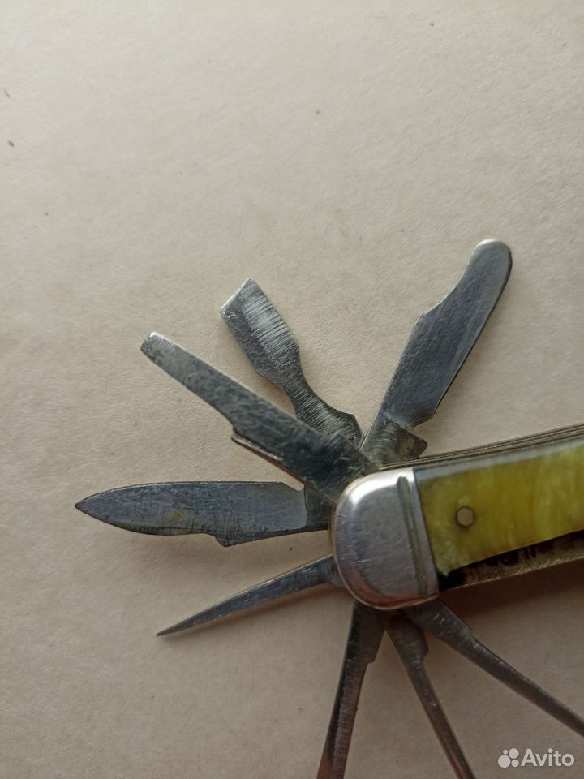

# Редкий складной нож СССР Ворсма 50е-г

- **Цена:** 8 800 ₽
- **Город:** Ставропольский край, Железноводск
- **Опубликовано:** Вчера
- **Ссылка:** https://www.avito.ru/zheleznovodsk/ohota_i_rybalka/redkiy_skladnoy_nozh_sssr_vorsma_50e-g_8369846145

## Фото

## Описание
Один из самых достойных складных ножей/мультитулов времён СССР в коллекцию. Завод складных ножей г. Ворсма, отличное состояние, 5 рядов, 15 предметов, латунь, перламутр.
