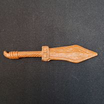
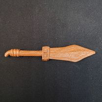
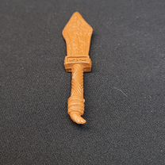
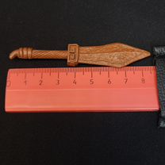

# Кинжал игрушечный винтажный, СССР. Пластмасса, аксессуар для куклы или солдатика

- **Цена:** 556 ₽
- **Город:** Орловская обл., Орёл
- **Опубликовано:** 1 час назад
- **Ссылка:** https://www.avito.ru/orel/kollektsionirovanie/kinzhal_igrushechnyy_vintazhnyy_sssr._plastmassa_aksessuar_dlya_kukly_ili_soldatika_8369497733

## Фото

## Описание

Небольшой винтажный декоративный предмет в форме древнего клинка или ритуального ножа, выполненный из пластика теплого коричневого оттенка. По размеру это миниатюра, примерно 8 см в длину, с выразительным силуэтом и хорошо проработанным рельефом. Лез...
