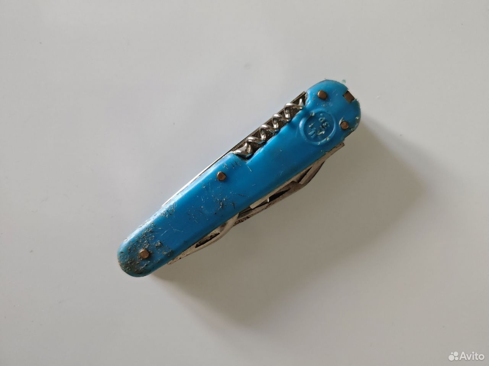

# Редкий складной нож СССР «Олимпиада-80» (Ворсма)

- **Цена:** 1 055 ₽
- **Город:** Нижегородская обл., Нижний Новгород
- **Опубликовано:** 3 часа назад
- **Ссылка:** https://www.avito.ru/nizhniy_novgorod/ohota_i_rybalka/redkiy_skladnoy_nozh_sssr_olimpiada-80_vorsma_8408818646

## Фото

## Описание
Оригинальный винтажный многопредметный складной нож, выпущенный заводом «Октябрь» (г. Ворсма) специально к Олимпийским играм 1980 года в Москве. Настоящая находка для коллекционеров советского антиквариата, ценителей ножевой истории СССР и тематики ...
