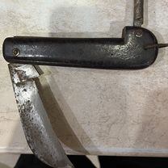
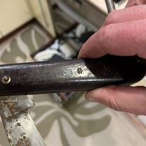

# Боцманский нож СССР

- **Цена:** 8 033 ₽
- **Город:** Ленинградская обл., Киришский р-н, Киришское городское поселение, Кириши
- **Опубликовано:** 1 час назад
- **Ссылка:** https://www.avito.ru/kirishi/ohota_i_rybalka/botsmanskiy_nozh_sssr_8483080043

## Фото

## Описание

Советский боцманский (шлюпочный) нож, специализированный инструмент для флотских нужд. Завод «Октябрь» (г. Ворсма, Горьковская область).
